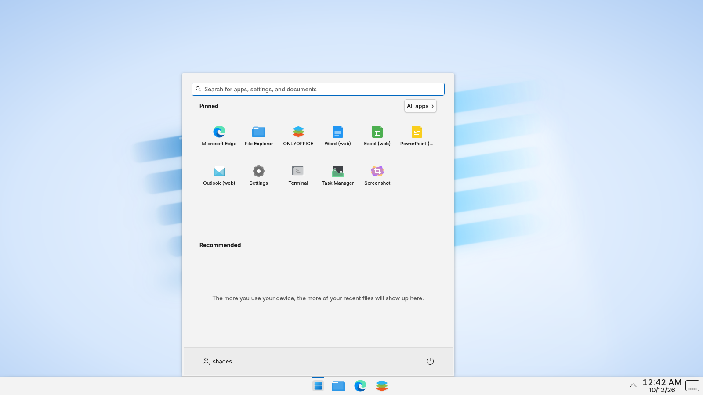

# Shades

*You use shades to cover windows.*

Shades is a just-for-fun Linux distro that feels like Windows 11, without the clutter and slowness.
It is built on **Debian 13** with a heavily customized **KDE Plasma 6** desktop.

## Goals

- **Familiar:** Windows 11-style taskbar, Start menu, Explorer-like file manager, and Win-key shortcuts.
- **Lean:** no telemetry, ads, or bundled trials; a small set of default apps.
- **Runs Windows apps:** Wine, with double-click `.exe` and `.msi` support.
- **Office:** ONLYOFFICE by default; Microsoft's Office web apps through Edge for Linux.

Shades ships no Microsoft logos, fonts, or wallpapers. It uses look-alikes instead.



## What it looks like

- **Taskbar:** centered Start button and pinned apps (File Explorer, Edge, ONLYOFFICE),
  tray and clock on the right, flush to the bottom.
- **Start menu:** Shades' own Windows 11-style menu: search on top, a "Pinned" grid with
  "All apps", "Recommended" recent files, and your account and power button along the bottom.
- **Titlebars:** Windows 11-style, via [Klassy](https://github.com/paulmcauley/klassy): title on the
  left, wide flat minimize / maximize / close buttons, red close on hover, rounded corners.
- **Theme:** Shades Light colors (Windows 11 greys and blue accent), Fluent icons, Inter font.
- **Windows names:** File Explorer, Task Manager, Settings, Terminal, Screenshot.
- **Solid, not see-through:** menus and panels are opaque. Virtual machines have no GPU for blur,
  and translucency without blur looks muddy.
- **File Explorer:** Dolphin, with Documents, Downloads, Pictures, and so on in the sidebar.
- **No splash screen, no hot corners, no file indexing.**

| Shortcut | Does |
|---|---|
| Win | Start menu |
| Win+E | File Explorer (Dolphin) |
| Win+R | Run / search |
| Win+I | Settings |
| Win+L | Lock |
| Win+D | Show desktop |
| Win+V | Clipboard history |
| Win+Up / Win+Down | Maximize / restore |
| Win+Left / Win+Right | Snap to half the screen |
| Win+Tab | Task view (Overview) |
| Win+Shift+S | Screenshot (Spectacle) |
| Ctrl+Shift+Esc | Task Manager (System Monitor) |
| Alt+Tab | Switch windows (thumbnail grid) |

## Apps

| App | For |
|---|---|
| Microsoft Edge | Default browser and PDF viewer. Ships with policies that skip the first-run tour and turn off telemetry, shopping, rewards, Copilot, and the news feed. |
| ONLYOFFICE | Opens Word, Excel, and PowerPoint files (and OpenDocument). |
| Word / Excel / PowerPoint / Outlook (web) | Microsoft's Office web apps in their own Edge windows. Needs a Microsoft account. |
| Wine | Runs Windows programs: double-click any `.exe` or `.msi`. Includes Wine's .NET (Mono) and web engine (Gecko), and Wine sets itself up silently at first login. |
| Winetricks | Adds Windows runtimes (Visual C++, fonts, and so on) that some programs need. |

Microsoft 365's desktop apps don't run reliably under Wine, so the web apps are the "real Office" option.

## Roadmap

1. ✅ Repo and tooling
2. ✅ Desktop playground in Docker
3. ✅ Windows 11 look
4. ✅ Windows-app layer (Wine, ONLYOFFICE, Edge, Office web apps)
5. ⬜ Bootable ISO with installer (`live-build`, Calamares)
6. ⬜ Real targets: laptop, and server VM with remote desktop

## Try the desktop in Docker

Docker can't boot the distro itself, but it can run the desktop so you can try the look and the apps.

```bash
docker compose up -d --build
```

Then open <http://localhost:6080/vnc.html?autoconnect=1&resize=scale> in a browser.
The session has no password, so the port is bound to localhost only.

To stop it:

```bash
docker compose down
```

Give Docker at least 6 GB of memory (Docker Desktop → Settings → Resources); the desktop
plus Edge and ONLYOFFICE won't fit in the default 2 GB.

## Still to do

- **Login screen and boot splash:** these come with the ISO, since Docker never shows them.
- **KDE Wallet:** off by default so apps don't show a setup wizard. On the installed system,
  an auto-unlocking wallet (kwallet-pam) would protect saved passwords better.
- **Audio and volume:** add PipeWire and the volume applet in the ISO.

## Container quirks

These only affect the Docker playground, not the real distro:

- No systemd, so `start.sh` starts KDE's shortcut service (`kglobalacceld`) itself before Plasma.
- No GPU, so KWin renders in software (llvmpipe).
- Edge's sandbox needs user namespaces, so `compose.yaml` relaxes Docker's seccomp filter.
- System Monitor can't see disks or per-app usage.

## Layout

| Path | What |
|---|---|
| `rootfs/` | Files laid over the system: `/etc/xdg` defaults, `/etc/skel` user defaults, theme, artwork |
| `rootfs/usr/share/plasma/plasmoids/org.shades.startmenu/` | The Windows 11-style Start menu |
| `scripts/install-apps.sh` | Installs Wine, ONLYOFFICE, and Edge. Shared by Docker and the ISO |
| `scripts/setup-rootfs.sh` | Installs `rootfs/` and patches KDE defaults. Shared by Docker and the ISO |
| `artwork/` | Source art (the wallpaper SVG is rendered to PNG at build time) |
| `container/` | Dockerfile and startup script for the desktop playground |
| `compose.yaml` | Runs the playground on port 6080 |

Third-party pieces downloaded at build time: the
[Fluent icon theme](https://github.com/vinceliuice/Fluent-icon-theme) (GPL-3.0),
[Klassy](https://github.com/paulmcauley/klassy) (GPL, built from source), and Wine's Mono and Gecko
add-ons. Edge and ONLYOFFICE come from their vendors' own apt repositories.
